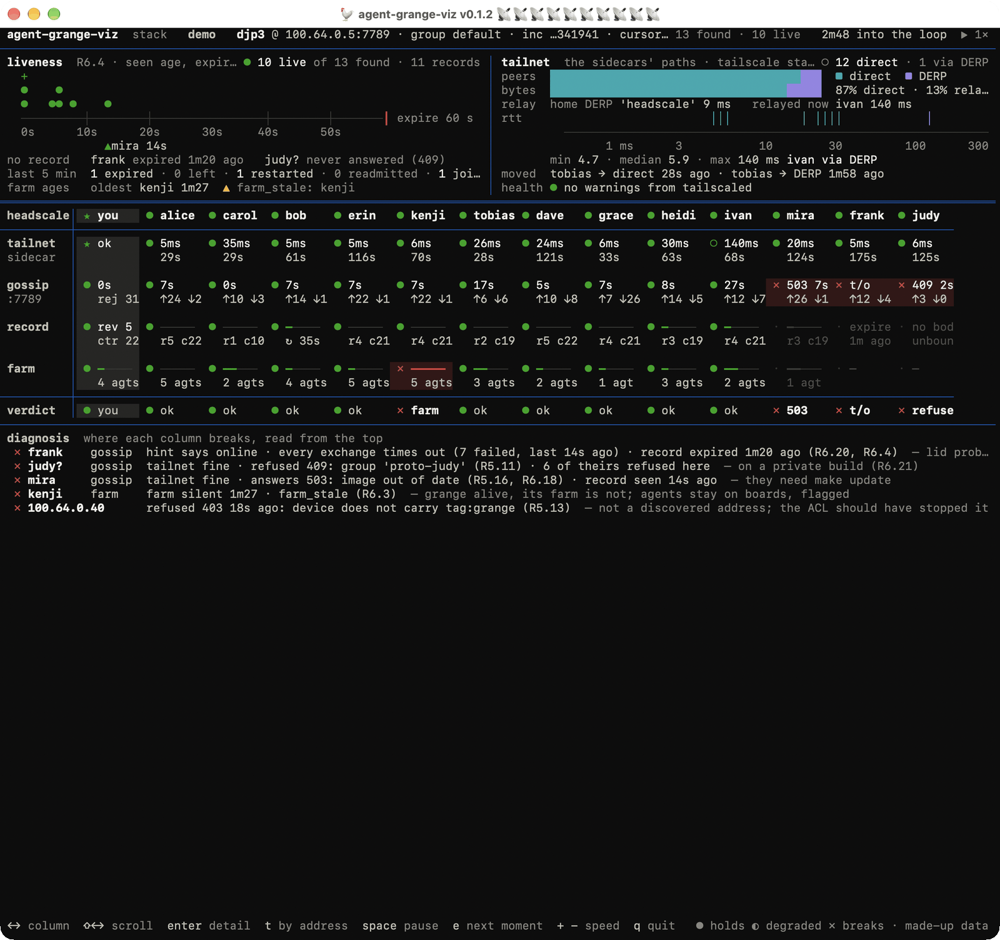

# 🐓 agent-grange-viz 📡📡📡

**See whether your team's granges are talking to each other, and where it breaks when one is not.**

Aaah!  A teammate's agents fell off your board an hour ago. Is their laptop shut? Is their
grange running an old image? Did their farm stop reporting, or is it your own sidecar that lost
the network? The board cannot say: it only shows who is missing. agent-grange-viz is a Mac app
that watches the plane the status travels on, one column for every teammate's grange and one
row for every layer between you and them, so the first thing that fails is the first red mark
you read. (A grange is the hall a farming community meets in.)

It works alongside [agent-farm](https://github.com/djp3/agent-farm),
[agent-grange](https://github.com/djp3/agent-grange) and
[agent-frolic](https://github.com/djp3/agent-frolic): see
[below](#made-to-work-with-agent-farm-agent-grange-and-agent-frolic).

**[Download for Mac](https://github.com/djp3/agent-grange-viz/releases/latest)** · macOS 27+ on
Apple silicon · free and open source



### Where it breaks is where the column turns red

Every grange your sidecar can find gets a column, and every layer of the plane a row:
headscale, the tailnet path, gossip, the record your grange holds, their farm. A column is
green down to the first layer that fails. That cell is marked ✗, everything beneath it greys
out as its consequence, and one word under the column names it: `timeout`, `refused`, `503`,
`silent`, `expired`, `no farm`. [The verdicts](#the-verdicts) lists them all.

### A closed lid, an old image and a silent farm look different

They break at different heights. A shut laptop: headscale still says online, and every
exchange times out. A build on another group: the tailnet is fine, and gossip is refused with
409. An image behind the tag: 503 on everything. A farm that stopped: the grange is alive and
flags its own farm stale. Below the grid the diagnosis says each one in plain words, with the
evidence, the requirement it comes from, and whose move it is.

### Your own side, too

Your column is the first one. When your sidecar cannot reach headscale it turns amber and
says the tunnels already up still work. When nothing answers on the grange's port, the last
picture freezes, dimmed, and the app says what Docker knows about the two containers. And
when your grange's image is out of date, it is up but not running: it answers 503 to
everything and gossips with nobody. The app then says so, shows nothing the grange said
before, and gives the fix, `make update`.

### How many granges you reach, without opening the window

The title bar carries one 📡 for each teammate's grange whose record yours holds, up to ten.
The Dock, Mission Control and the window switcher show it too.

### Every cell explains itself

Hover any cell: the exact numbers, what its mark means, and where the data comes from. Hover a
row's name for the key to that row.

### It only reads. It shows no agents and no pull requests.

Which agents are at work is [agent-farm](https://github.com/djp3/agent-farm)'s to show, and
which pull request each is on is [agent-frolic](https://github.com/djp3/agent-frolic)'s. This
app shows the plane between them: at most a count of agents per grange, never a name or a
state. It never pushes anything to the grange, and it changes nothing in Docker.

## Install

1. Download `agent-grange-viz-<version>.zip` from the
   [latest release](https://github.com/djp3/agent-grange-viz/releases/latest), unzip it and
   drag `agent-grange-viz.app` to Applications.
2. Open it. The app is notarized, so it opens like any other download.

Updates take care of themselves: the app checks GitHub once a day and offers each new release
with its notes. **agent-grange-viz ▸ Check for Updates…** checks now. (Versions 0.1.1 and
0.1.2 came before this and check for nothing: from those, download the newer release by hand
once.)

You need macOS 27 (Golden Gate) or later on Apple silicon. To watch something real you also
need a grange running on this Mac ([agent-grange](https://github.com/djp3/agent-grange):
`cd docker && make up`). Without one the app says so, and **Viewer ▸ Show the Demo** (⌘D)
shows a made-up team instead.

**On macOS 26 (Tahoe) or earlier?** The app carries its own copy of Python, and that copy is
built for macOS 27, so the app can't run on an earlier macOS: macOS refuses to open it and
says it needs macOS 27.0 or later. The viewer itself doesn't need macOS 27, so you can run it
from source in a terminal instead. Install Python 3.14 (python.org's installer runs on
earlier macOS versions), then:

    git clone https://github.com/djp3/agent-grange-viz.git && cd agent-grange-viz
    python3.14 -m venv .venv && .venv/bin/pip install -r requirements.txt
    .venv/bin/python main.py

Run that way, it has no window or menus of its own (`--demo` and `--port N` stand in for the
Viewer menu), it gets no automatic updates (`git pull` brings it up to date), and its
settings and log stay in that folder.

## The window

Under the title bar, from top to bottom:

- **The top line**: this Mac's grange (its id, tailnet address, group, incarnation and
  cursor), how many granges were found and how many are live, and the clock. When the grange
  cannot be reached, or is not running, this line says that instead.
- **Two panels.** On the left, **liveness**: every record's seen age as a dot on an axis from
  0 to 60 seconds, the expiry wall at its end, with the slow ones named, what has no record
  and why, what expired, left, restarted or joined in the last five minutes, and the oldest
  farm age. On the right, **tailnet**: how many peers are reached directly and how many
  through the DERP relay, by count and by bytes, the home relay, round trips on a log scale
  with the slowest named, recent path changes, and tailscaled's own health.
- **The grid**, under a double rule: a column for each grange, yours first and pinned. Where
  the grange says each one's place in the gossip ring (`GET /v1/mesh`; the demo has it), the
  others follow in that order: the ring successor, the neighbours, the repair pool, and the
  addresses outside the live set. The rows are below.
- **The verdict**: one word under each column.
- **The diagnosis**: every column that breaks or degrades, in plain words. Something only
  you can fix is yellow. Sources that are no teammate at all (a device without the grange's
  tag, refused by the identity check) are listed here too.

The title bar reads 🐓 agent-grange-viz and its version, then one 📡 for each teammate's
grange that is bound and whose record yours still holds, up to ten, so the Dock, Mission
Control and the window switcher show how many granges yours reaches. A grange is bound once
an exchange has named who answers at its address. Only `GET /v1/mesh` says that, so where the
grange has not answered it a record held is enough. A teammate whose record has expired or
left has no dish, a teammate on two devices has one, and there are none while nothing answers
on the grange's port or its image is out of date.

### The rows

| row | first line | second line |
|-----|------------|-------------|
| **headscale** | a mark before each name: ● online, ○ offline, as headscale tells your sidecar; ★ is you | |
| **tailnet** | the path and its round trip in whole ms: ● direct, ○ through DERP, ✗ no path | seconds since the last WireGuard handshake (`>999s` past that) |
| **gossip** | ● how long since the last good exchange; ✗ why the last one failed (`409` another group or protocol, `503` image out of date, `403` not a tagged grange, `t/o` no answer) and how long ago; ○ never tried | exchanges sent ↑ and received ↓ |
| **record** | the seen age as a bar filling toward the 60 second expiry | `r` rev and `c` counter, or ↻ after a restart |
| **farm** | their farm's age as a bar filling toward the 60 seconds at which it is called stale | how many agents it reports |

In your own column the tailnet cell is your sidecar's state: ★ ok, ◐ it cannot reach
headscale, ✗ the grange cannot reach its socket, or it is logged out. While your sidecar
cannot answer, every other tailnet cell is last known, and greys out to say so.

A cell that reads `· not known` is one nothing can vouch for: its tip says why.

### The verdicts

| verdict | the column breaks at | what it means |
|---------|----------------------|---------------|
| `ok` | nowhere | every layer holds |
| `offline` | tailnet | headscale says the device is gone: laptop off, sidecar stopped, or removed |
| `timeout` | gossip | no exchange is answered; with headscale still saying online, a lid is probably shut |
| `refused` | gossip | it answers 409 or 403: another group or protocol, or not a tagged grange |
| `outdated` | gossip | it answers 503: its image is out of date, and they need `make update` |
| `silent` | record | its record is still held and has not been refreshed for 45 seconds; it expires at 60 |
| `expired`, `left`, `gone` | record | the record went: it timed out, their grange said goodbye, or (where only `GET /v1/mesh` could tell) one of the two |
| `no body` | record | a device with the grange's tag, and no record for it |
| `no farm` | farm | their grange is alive and their agent-farm has stopped reporting to it |
| `quiet`, `farm` | (degraded) | a record or a farm that is late, not yet lost |
| `unknown` | (not known) | your own grange is not running, so only the tailnet row can be judged |

Your own column reads `you`, or in yellow what only you can fix: `stopped` (your image is out
of date), `fix me` (your grange has not gossiped in a while), `no farm`, `dup id` (another
grange runs with your id), or your sidecar's state.

In a narrow column a verdict is cut to fit: `t/o`, `refuse`, `503`, `gone`, `farm`.

### Keys

| key | action |
|-----|--------|
| ← → | pick a column |
| shift+← shift+→, the wheel, the trackpad | scroll the columns when they do not all fit (yours stays pinned) |
| enter | open or close the selected column's full values, beside the diagnosis |
| t | order the columns by role, or by address (the order the gossip ring walks) |
| hover | what a cell shows, what its mark means, where it comes from |
| q | quit |

In the demo also: space pauses, `e` jumps to the next scripted moment, `+` and `-` change the
speed.

The View menu changes the text size (⌘+ / ⌘-), picks any fixed-pitch font installed on the
Mac, and toggles font smoothing; the window remembers all of that with its size and place.

### When your own grange is the problem

| what you see | what is happening | the fix |
|--------------|-------------------|---------|
| the last picture, dimmed, and "nothing answers on 127.0.0.1:7788" | the grange's port is closed: the containers are stopped, or the sidecar is and took the grange's network with it | `cd docker && make up` |
| "the grange is not running", and *not known* in the gossip, record and farm rows | its image is behind the tag, so it answers 503 to everything and gossips with nobody | `cd docker && make update` |
| your tailnet cell amber, `no control` | tailscaled cannot reach headscale; tunnels already up keep working | nothing, unless it lasts |
| your tailnet cell red, `no socket` | the grange cannot reach its sidecar's socket: discovery is frozen and incoming exchanges are refused | `docker compose logs tailscale`; `make up` if it stays wedged |
| your tailnet cell red, `logged out` | tailscaled is logged out: no tailnet at all | ask whoever runs headscale whether the node was removed, then `make up` |

While the grange is not running the app shows nothing it said before. Nothing keeps those
values up, and a record whose age stands still looks like one that is live. The headscale and
tailnet rows carry on, since they come from your sidecar.

## Where each row comes from

The app reads four routes on the grange's local port: `GET /health`, `GET /v1/agents`,
`GET /version` and `GET /v1/mesh`. From the first three, and the sidecar asked through
Docker, it shows:

- the **headscale** row and the **tailnet** row (the sidecar's `tailscale status` and `ping`);
- the **record** row's bar (how long since each record was refreshed);
- the **farm** row (farm age, the stale flag, the agent count);
- your own column, the liveness and tailnet panels, and the screens for a grange that cannot
  be reached or is not running.

The rest comes from `GET /v1/mesh`: each peer's **gossip** cell (last exchange, failure code,
counts, its place in the ring), rev and counter, which address is bound to which id, and
whether a record that went away expired or left. The app asks for it when it starts and once
a minute after that. While a grange has not answered it those cells read *not known*, and
their tips say that this is why; they fill in the moment it answers.
[docs/openapi.yaml](docs/openapi.yaml) is the specification of the route, and
[docs/data-sources.md](docs/data-sources.md) is the survey behind it.

**The demo** fills every row. `--demo` (or **Viewer ▸ Show the Demo**) runs a made-up team of
thirteen granges through a four-minute loop: a lid closes, a path falls back to DERP, a
private build is refused, a teammate joins, a farm goes quiet, a grange restarts, a device
without the tag knocks, an image goes stale, headscale becomes unreachable, the grange loses
its sidecar's socket, and the sidecar container stops. Every name and number in it is
invented, and the screen says so.

## What it reads, and what it never does

- **The grange's local API**, on `127.0.0.1` and the port in the settings (7788 unless you
  changed `GRANGE_PORT`): the four `GET` routes above. It never sends `PUT /v1/farm`: that is
  agent-farm's voice, and the app has none.
- **The Docker socket**, if you allow it (you do by default): it lists the two agent-grange
  containers and their state, and runs `tailscale status` and `tailscale ping` inside the
  sidecar. It starts, stops and changes nothing. Turn it off with `"use_docker": false` in
  the settings or `--no-docker`; the headscale and tailnet rows then show only what the
  grange itself relays of its sidecar in `GET /v1/mesh`.
- **GitHub, once a day**, to ask whether there is a newer release. That is the Mac app's
  update check; a run from source makes none. The request names the app and its version, and
  nothing about your granges goes with it.
- **Nothing else.** It sends none of what it reads anywhere, and keeps no history on disk:
  what the panels count is held in memory while the app is open.

## Made to work with agent-farm, agent-grange and agent-frolic

agent-grange-viz is the fourth of four programs for teams where coding agents do much of the
work. Each of the other three works without it:

- **[agent-farm](https://github.com/djp3/agent-farm)** watches the agents on your Mac: which
  are at work, which are idle, and which are waiting for you.
- **[agent-grange](https://github.com/djp3/agent-grange)** carries that between Macs. Each
  person runs one. Their agent-farm reports to it, and the granges of a team pass what they
  know on to each other over a private network.
- **[agent-frolic](https://github.com/djp3/agent-frolic)** puts it on the pull requests:
  whose agents are on which one, beside who each pull request waits on.
- **agent-grange-viz** watches the plane the other three depend on. It shows no agents and no
  pull requests, only whether each grange can be reached, by what path, how fresh its record
  is, and what was refused.

```
   your Mac                                       a teammate's Mac

   agent-farm ──▶ agent-grange ◀──────────────▶ agent-grange ◀── agent-farm
                    │      ▲                          │
                    ▼      └── agent-grange-viz       ▼
               agent-frolic        (reads only)  agent-frolic
```

## Files and logs

| what | where |
|------|-------|
| settings | `~/Library/Application Support/agent-grange-viz/settings.json` |
| log | `~/Library/Logs/agent-grange-viz/agent-grange-viz.log` |

Run from a checkout, both stay next to the code instead (`settings.json`, `logs/`), ignored
by git. **Viewer ▸ Open Log Folder** and **Reveal Settings File** open them.

The log records what changed about reaching the grange and its sidecar, why anything failed,
and any crash; never who is on the board. If the viewer inside the window ever stops, the
window says so and **Viewer ▸ Restart Viewer** (⌘R) starts it again.

The settings file holds three things, and no secret (the app has none):

| key | default | meaning |
|-----|---------|---------|
| `grange_port` | `7788` | the grange's local port on 127.0.0.1 (1 to 65535) |
| `use_docker` | `true` | may the app ask the Docker socket about the sidecar |
| `docker_socket` | `""` | the socket's path; empty finds it: `DOCKER_HOST`, then `/var/run/docker.sock`, then `~/.docker/run/docker.sock` |

A key the file gets wrong is ignored, and the default used.

## How it works

The grange answers on a local port. `GET /v1/agents` is held open on the grange's cursor for
a second at a time, so a change arrives at once and the ages stay fresh; `GET /health` is
read every two seconds, and `GET /v1/mesh` is asked when the app starts and once a minute.

The sidecar is asked through the Docker socket, by running commands inside its container:
`tailscale status` and the two containers' state every five seconds, one `tailscale ping` a
second in turn over the peers that are online, and the byte counters every fifteen seconds.

What neither source keeps, the app works out from one reading to the next: a record that
disappears close to the 60 second limit expired, and one that disappears early left; a path
that changes between direct and DERP is an event. It remembers five minutes of those, in
memory only.

The app is a Python program (Textual) running inside a native window (SwiftTerm), the way
agent-farm and agent-frolic are; see [DEVELOPMENT.md](DEVELOPMENT.md) to run it from source,
build the app or cut a release.

## License

GPL-3.0-or-later. See [LICENSE](LICENSE) and [NOTICE](NOTICE).

The icon is this project's own drawing and is under the same license.
